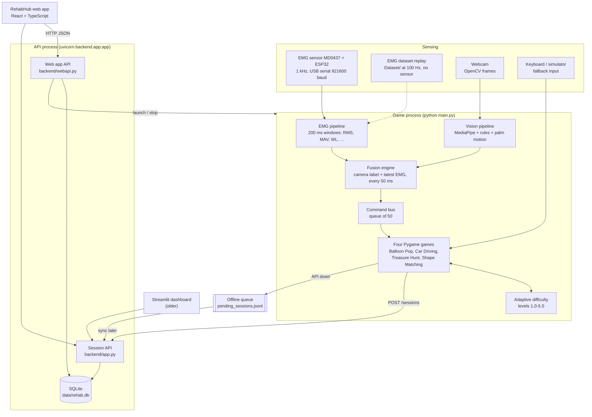
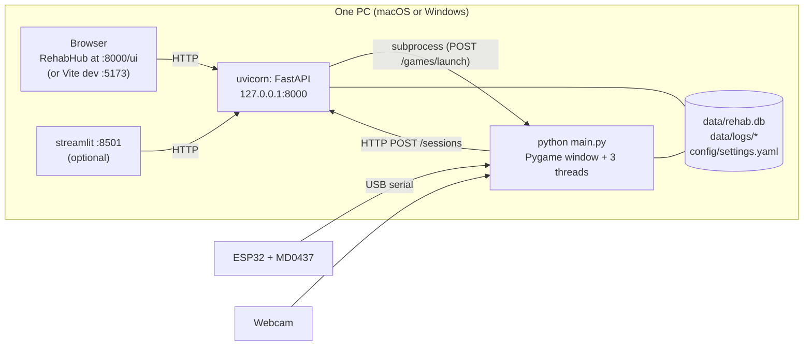
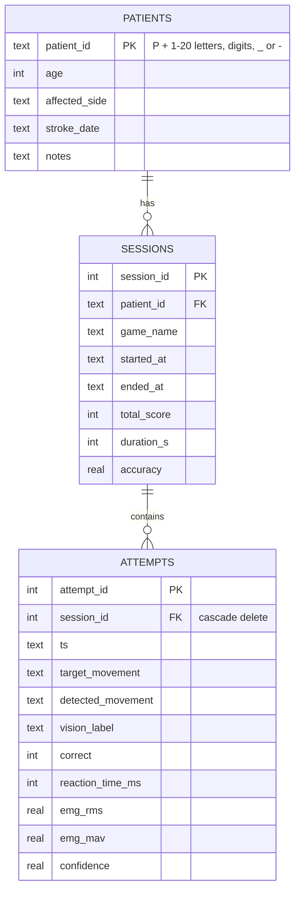

# System architecture

The camera decides every game movement, the EMG sensor adds a muscle-activity measurement to each command (and in Webcam + EMG mode holds back grip actions below the patient's effort threshold), and every session is stored by a local API that a web app (RehabHub) reads. Everything runs on one PC.

This document describes the system as implemented on 2026-10-18 (branch `main`). It replaces the architecture in `Stroke_Rehab_System_Documentation.pdf` and the root `architecture.md`; see [corrections.md](corrections.md) for what those got wrong.

## 1. Component view



| Layer | Components | Responsibility |
|---|---|---|
| L1 Sensing | MD0437 + ESP32, webcam, keyboard | Capture muscle activity and hand images |
| L2 Signal processing | `src/preprocessing`, `src/vision/hand_tracker.py` | Filter or pass through the EMG envelope; find 21 hand landmarks |
| L3 Features and labels | `src/features`, `rule_classify`, palm-motion logic in `src/realtime/pipeline.py` | EMG activity features; camera movement labels |
| L4 Fusion | `src/fusion/fusion_engine.py` | One command per 50 ms: camera label + EMG features |
| L5 Application | `src/games` | Turn commands into exercises, score attempts, adapt difficulty |
| L6 Data | `backend/`, SQLite, `data/logs` | Store patients, sessions and attempts |
| L7 Presentation | Pygame windows, RehabHub, Streamlit | Patient feedback; therapist monitoring and control |

## 2. Processes and deployment

Three or four operating-system processes run on the same PC.



- **API process:** `python -m uvicorn backend.app:app --host 127.0.0.1 --port 8000`. Serves the session API, the web app API and, when `webapp/dist` exists, the built web app at `/ui`.
- **Game process:** started by the web app (`POST /games/launch`), the Streamlit dashboard, or a terminal. Only one game runs at a time from the web app. Its output goes to `data/logs/dashboard_game.log`.
- **Web app:** production build served by the API; in development `npm run dev` serves it on port 5173 and forwards `/api` to port 8000.
- **Streamlit dashboard:** optional older view on port 8501.

Nothing listens on a public interface, and there is no authentication. Keep everything on `127.0.0.1`.

## 3. Runtime threads and timing

Inside the game process three background threads share one `latest` dictionary under a lock.

| Thread | Code | Rate | Writes | Notes |
|---|---|---|---|---|
| EMG | `pipeline._emg` or `emg_replay.replay_emg` | Every serial sample (1 kHz); a feature window every 100 samples | `emg_features`, `emg_level`, sample and feature times | Data older than 2.5 s counts as missing; Webcam + EMG games show a waiting screen |
| Vision | `pipeline._vision` | Every camera frame (about 30 fps) | `vis` (label, confidence), `vis_ts_ms`, `pointer`, `fist`, `frame` | MediaPipe, gesture rules, 5-frame smoothing, palm-motion directions |
| Fusion | `pipeline._fusion` | Every 50 ms | Command bus (50 slots; oldest dropped when full) | Adds EMG features and frame time to the camera label |
| Game loop | `src/games/*.py` | 30 frames per second | Attempts, score, latency samples | Reads the bus plus `latest["pointer"]` and `latest["fist"]` |

### One movement from camera to dashboard

```mermaid
sequenceDiagram
    participant Cam as Webcam
    participant Vis as Vision thread
    participant Fus as Fusion thread
    participant Game as Game loop
    participant API as API + SQLite
    participant Web as RehabHub
    Cam->>Vis: frame (capture time stored)
    Vis->>Vis: 21 landmarks, rule label, 3-of-5 smoothing, palm-motion direction
    Vis->>Fus: latest["vis"] = (label, confidence)
    Fus->>Fus: confidence < 0.6 means Rest; 5-command majority; attach EMG window
    Fus->>Game: command on the bus (every 50 ms)
    Game->>Game: compare with target, record attempt (reaction time, EMG RMS/MAV, delay)
    Game->>API: POST /sessions when the session ends (or offline queue)
    Web->>API: GET /overview, /patients/{id}/progress
```

## 4. Interfaces and data contracts

**ESP32 serial line** (921600 baud, one line per sample): `timestamp_ms,adc_value`, for example `48213,1873`. Values outside 0-4095, or lines without exactly two fields, are ignored.

**Fused command** (fusion thread to game). Values are illustrative:

```json
{"command": "Hand_Close", "confidence": 0.92, "source": "vision+emg",
 "timestamp_ms": 1760600000123, "vision_ts_ms": 1760600000071,
 "emg_rms": 412.6, "emg_mav": 371.2,
 "emg_features": {"RMS": 412.6, "MAV": 371.2, "VAR": 0, "STD": 0, "PEAK": 0, "WL": 0, "ZC": 0, "SSC": 0}}
```

`source` is `vision` when no EMG runs; the simulator sends `simulator` with only command, confidence and time.

**Runtime movement labels** (`config/labels.yaml`): `No_Hand, Rest, Hand_Open, Hand_Close, Left, Right, Up, Down`. Keyboard S/P also send `Supination`/`Pronation`, used only as a bonus lock in Treasure Hunt's keyboard mode.

**Attempt record:** `ts, target_movement, detected_movement, vision_label, correct, reaction_time_ms, emg_rms, emg_mav, confidence`.

**Session upload** (`POST /sessions`): `patient_id, game_name, total_score, duration_s, attempts[]`. The API computes accuracy = correct attempts / attempts.

**Game launch** (`POST /games/launch`): runs `python main.py <mode> --game <id> --patient <code> --difficulty <level> --duration <seconds>`.

## 5. Data model and storage



Deleting a patient in the web app deletes their sessions, and attempts go with their session.

| File | Written by | Contents |
|---|---|---|
| `data/rehab.db` (or `REHAB_DB`) | API | The three tables |
| `data/logs/pending_sessions.jsonl` | Games when the API is down | One session per line, uploaded later |
| `data/logs/game_levels.json` (or `REHAB_GAME_STATE`) | Games in auto difficulty | Last level per patient and game |
| `data/logs/latency_<game>_<time>.csv` | Games in webcam modes | Frame-to-game delay per command |
| `data/logs/dashboard_game.log` | Web app / Streamlit launcher | Output of the running game |
| `data/raw/emg/*.csv` | EMG and fused loggers | Your own recordings |
| `data/raw/vision/*.csv` | Landmark recorder | 21 landmarks (x, y, z) per frame + label |
| `data/features/*.csv`, `results/` | Feature builder, trainer, reports | Window features, metrics, figures, subject splits |
| `data/processed/moment/` | `src.data.prepare_finetune` | Fine-tuning windows (`windows.npz`), `manifest.csv`, `metadata.json` |
| `Dataset/public/`, `data/processed/public/` | `src.data.download_public`, `src.data.public_emg` | Downloaded public data and its converted windows (not in git) |
| `models/moment/<run>/` (committed) | `src.models.finetune_moment` | Fine-tuned adapters, metrics, logs, settings for each run |
| `config/settings.yaml` | You or the web app Settings page | All tunables |

Raw data, the database, logs, feature tables and saved models are kept out of git by `.gitignore`. `Dataset/` is committed.

## 6. Repository structure

```text
FYP/
├── main.py                   game entry point: mode, game, patient, difficulty, duration
├── config/                   settings.yaml (tunables), labels.yaml (runtime labels)
├── firmware/emg_acquisition/ ESP32 sketch: 1 kHz ADC on GPIO34, USB serial
├── src/
│   ├── acquisition/          emg_logger, fused_logger, landmark_recorder
│   ├── preprocessing/        filters, windowing
│   ├── features/             emg_features (8 features), build_dataset
│   ├── data/                 public_datasets (Dataset/ loader), prepare_finetune (MOMENT windows),
│   │                         download_public, public_emg (public data)
│   ├── models/               train_emg (LDA/SVM/RF), finetune_moment (MOMENT-1, ready)
│   ├── evaluation/           emg_activity_report, latency_report, compare_models, public_data_gain
│   ├── vision/               hand_tracker (MediaPipe wrapper, rule_classify)
│   ├── fusion/               fusion_engine
│   ├── realtime/             pipeline (threads, command bus), simulator, emg_replay
│   ├── games/                game_engine (BaseGame), 4 games, difficulty, summary, audio
│   └── utils/                config (settings, env overrides), session_sync
├── backend/                  app.py (session API, SQLite), webapi.py (web app API)
├── webapp/                   RehabHub: React 19 + TypeScript + Vite
├── dashboard/                dashboard.py (Streamlit, older)
├── Dataset/                  Healthy_person/S01-S09, stroke_patient/SP01, public/ (downloaded, not in git)
├── data/                     models/ (MediaPipe), raw/, features/, logs/
├── models/moment/            committed fine-tuning runs (LoRA adapters, metrics, logs)
├── results/                  tables/, figures/, splits.json
├── tests/                    62 pytest tests
└── docs/                     this documentation
```

## 7. Technology stack

Versions installed and tested on 2026-10-18.

| Area | Technology |
|---|---|
| Firmware | Arduino C++ for ESP32 |
| Runtime | Python 3.11.17 |
| Signal processing and ML | NumPy 2.4, SciPy 1.17, pandas 3.0, scikit-learn 1.9 |
| Vision | MediaPipe 1.1 (Tasks API hand landmarker), OpenCV contrib 4.11.0.86 |
| Games | Pygame 2.6 |
| API and database | FastAPI 0.143, Uvicorn 0.54, Pydantic 2.14, SQLite |
| Web app | React 19, TypeScript 5.8, Vite 6, React Router 6, Recharts 2; Node.js 18+ |
| Older dashboard | Streamlit 1.65, Plotly 7 |
| Serial | pySerial 3.5 |
| Tests | pytest 9.1 |
| Fine-tuning (separate `.venv-finetune`) | PyTorch 2.14, momentfm 0.1.4, peft 0.13, transformers 4.33, NumPy 1.25 |

## 8. Key design decisions

| Decision | Reason |
|---|---|
| The camera decides every game action | One EMG channel separates rest from activity but cannot tell gestures apart reliably |
| EMG is shown and logged as activity (RMS, MAV), never as strength | The MD0437 output is an envelope in ADC units, not a calibrated force |
| Games run as a separate process | Pygame needs its own window and main thread; a game crash cannot stop the API |
| One local PC, no accounts, coded IDs only | Ethics and privacy: no identifying health data, nothing exposed to a network |
| Offline queue for sessions | A session is never lost when the API is not running |
| Difficulty adapts to accuracy, not EMG | Accuracy exists in every input mode, including keyboard and webcam-only |
| Subject-wise splits for every model | 200 ms windows overlap by 50%, so random splits leak data |
