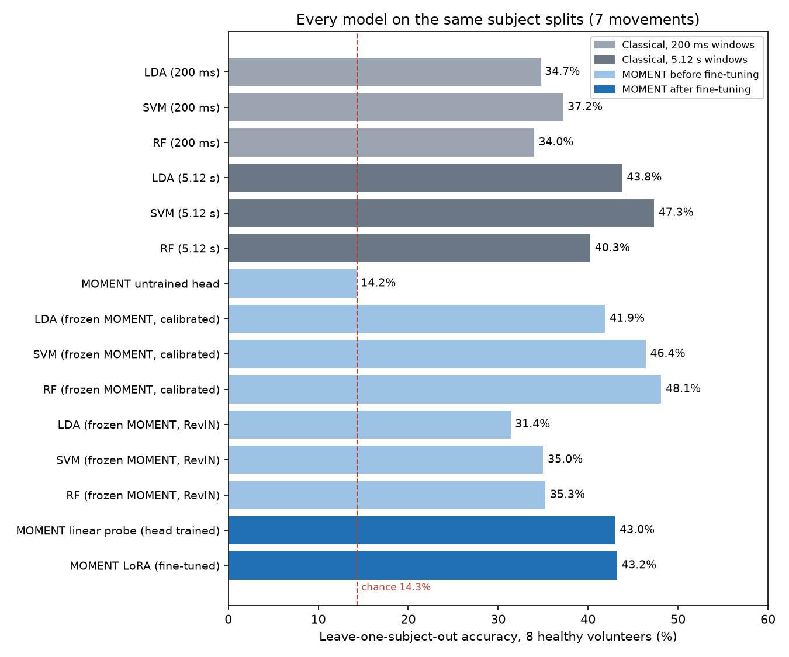

# Model comparison: classical models and MOMENT-1 before and after fine-tuning

On the same 8 volunteers and the same subject splits, the best EMG movement classifier is a **random forest on frozen (not fine-tuned) MOMENT-1 features: 48.1%** leave-one-subject-out accuracy over 7 movements (chance 14.3%). An SVM on hand-crafted features of the same 5.12 s windows is close behind (47.3%). Fine-tuned MOMENT-1 (LoRA) reaches 43.2%. The first headline comparison (fine-tuned MOMENT 43.2% vs SVM 37.4%) mostly measured window length (5.12 s vs 200 ms), not the model.

Run on 2026-10-18 with `src/evaluation/compare_models.py`. Every fine-tuned model was reloaded from its saved files in `models/moment/` and reproduced its training score exactly.



## Setup

| Item | Value |
|---|---|
| Data | `Dataset/Healthy_person`, 8 volunteers (S02-S09; S01 excluded for 39% lost samples), 7 movements: Rest, Hand_Open, Hand_Close, Left, Right, Up, Down |
| Extra test | Synthetic stroke patient `SYN_STROKE_01` (generated data, never trained on) |
| Leave-one-subject-out (LOSO) | 8 folds; each tests one volunteer. Train on 6, the 7th is MOMENT's early-stopping subject (classical models skip it) |
| Holdout | Train S02-S05, validation S06 (MOMENT only), test S07+S08+S09 (903 windows, 129 per movement) |
| Splits | Read from the saved runs (`models/moment/*/folds/*/fold.json`), so every method sees exactly the same people |
| Metrics | Accuracy (classes are balanced) and macro F1; chance = 1/7 = 14.3% |

## Methods

| Group | Method | Input | What is trained |
|---|---|---|---|
| Classical, 200 ms | LDA, SVM (RBF, C=10), random forest (200 trees) | 8 features (RMS, MAV, VAR, STD, PEAK, WL, ZC, SSC) of 200 ms raw-envelope windows; 34,764 windows | Whole classifier |
| Classical, 5.12 s | Same three | Same 8 features of the 5.12 s preprocessed windows MOMENT sees (log1p, per-subject z-score); 2,494 windows | Whole classifier |
| MOMENT before fine-tuning | Untrained head | MOMENT-1-small as downloaded, random classification head | Nothing |
| MOMENT before fine-tuning | Frozen features + LDA / SVM / RF | 512-number MOMENT embedding of each 5.12 s window; no MOMENT weight changed. Two variants: our per-subject calibration, or MOMENT's own per-window normalisation (RevIN) | Only the classical classifier |
| MOMENT after fine-tuning | Linear probe (Phase A) | 5.12 s windows | MOMENT's classification head (3,591 parameters) |
| MOMENT after fine-tuning | LoRA (Phase B) | 5.12 s windows | LoRA adapters on attention q, v + head (118,279 parameters) |

## Results: leave-one-subject-out (8 volunteers)

| Group | Method | Accuracy | Macro F1 |
|---|---|---|---|
| Classical, 200 ms | LDA | 34.7% | 0.297 |
| Classical, 200 ms | SVM | 37.2% | 0.321 |
| Classical, 200 ms | Random forest | 34.0% | 0.307 |
| Classical, 5.12 s | LDA | 43.8% | 0.381 |
| Classical, 5.12 s | SVM | 47.3% | 0.425 |
| Classical, 5.12 s | Random forest | 40.3% | 0.368 |
| MOMENT before fine-tuning | Untrained head | 14.2% | 0.059 |
| MOMENT before fine-tuning | Frozen + LDA (calibrated) | 41.9% | 0.392 |
| MOMENT before fine-tuning | Frozen + SVM (calibrated) | 46.4% | 0.425 |
| MOMENT before fine-tuning | **Frozen + random forest (calibrated)** | **48.1%** | **0.443** |
| MOMENT before fine-tuning | Frozen + LDA (RevIN) | 31.4% | 0.289 |
| MOMENT before fine-tuning | Frozen + SVM (RevIN) | 35.0% | 0.313 |
| MOMENT before fine-tuning | Frozen + random forest (RevIN) | 35.3% | 0.304 |
| MOMENT after fine-tuning | Linear probe | 43.0% | 0.369 |
| MOMENT after fine-tuning | LoRA | 43.2% | 0.369 |

## Results: holdout (test S07, S08, S09)

| Group | Method | Accuracy | Macro F1 |
|---|---|---|---|
| Classical, 200 ms | LDA / SVM / random forest | 36.0% / 40.5% / 37.5% | 0.310 / 0.365 / 0.361 |
| Classical, 5.12 s | LDA / **SVM** / random forest | 40.3% / **50.2%** / 45.0% | 0.337 / **0.453** / 0.440 |
| MOMENT before fine-tuning | Untrained head | 17.4% | 0.082 |
| MOMENT before fine-tuning | Frozen + LDA / SVM / random forest (calibrated) | 45.2% / 48.3% / 49.3% | 0.436 / 0.469 / 0.463 |
| MOMENT before fine-tuning | Frozen + LDA / SVM / random forest (RevIN) | 27.4% / 31.8% / 29.2% | 0.252 / 0.294 / 0.262 |
| MOMENT after fine-tuning | Linear probe / LoRA | 45.5% / 45.5% | 0.401 / 0.404 |

The holdout has only three test volunteers, so LOSO (all 8) is the more reliable ranking.

## Results: synthetic stroke patient

Trained on healthy volunteers only; LOSO values are the mean of the 8 fold models.

| Method | LOSO models | Holdout model |
|---|---|---|
| LDA / SVM / random forest, 200 ms | 26.0% / 27.5% / 37.4% | 22.5% / 30.6% / 36.5% |
| LDA / SVM / random forest, 5.12 s | 28.3% / 47.3% / **51.5%** | 32.6% / 30.6% / 28.2% |
| Frozen MOMENT + LDA / SVM / random forest (calibrated) | 45.5% / 48.9% / **52.2%** | 36.9% / 42.2% / **47.5%** |
| Frozen MOMENT + LDA / SVM / random forest (RevIN) | 23.0% / 24.2% / 21.4% | 27.6% / 18.3% / 16.9% |
| MOMENT LoRA (fine-tuned) | 43.4% | 35.9% |

The patient is generated data, so these numbers only show robustness to a different signal style, not clinical performance.

## Per movement (LOSO recall)

| Method | Rest | Hand_Open | Hand_Close | Left | Right | Up | Down |
|---|---|---|---|---|---|---|---|
| SVM, 200 ms | 81% | 46% | 66% | 23% | 9% | 19% | 11% |
| SVM, 5.12 s | 74% | 59% | **79%** | **47%** | **40%** | 23% | 5% |
| Frozen MOMENT + random forest | 78% | **74%** | 75% | 40% | 31% | 9% | **27%** |
| MOMENT LoRA | 72% | **74%** | 76% | 32% | 18% | 19% | 3% |

## Per volunteer (LOSO accuracy)

| Volunteer | SVM, 200 ms | SVM, 5.12 s | Frozen MOMENT + RF | MOMENT LoRA |
|---|---|---|---|---|
| S02 | 24.9% | 36.9% | 40.9% | 35.9% |
| S03 | 15.8% | 28.6% | 31.2% | 21.3% |
| S04 | 35.0% | 56.1% | 49.9% | 50.6% |
| S05 | 47.1% | 52.5% | 52.8% | 55.5% |
| S06 | 40.3% | 56.5% | 58.5% | 43.5% |
| S07 | 40.6% | 45.5% | 51.8% | 43.5% |
| S08 | 49.7% | 55.8% | 49.8% | 50.8% |
| S09 | 44.4% | 46.8% | 50.2% | 44.5% |

## Findings

1. **Window length matters most.** Moving the same SVM from 200 ms to 5.12 s windows raises LOSO accuracy from 37.2% to 47.3% (+10.1 points). Longer windows capture how activity changes during a movement.
2. **Pretrained MOMENT features help without any fine-tuning.** Frozen MOMENT embeddings with a random forest give the best LOSO result (48.1%) and the best synthetic-patient result (52.2%).
3. **Fine-tuning as configured did not beat frozen features.** The fine-tuned model's linear head (43.0-43.2%) is weaker than non-linear classifiers on the same frozen features (46.4-48.1%); LoRA added only 0.2 points over the linear probe. With about 1,900 training windows from 6 people, the adapters have little to learn from.
4. **Per-subject calibration is essential.** MOMENT's own per-window normalisation (RevIN) erases activity level and costs 11-13 points (35.3% vs 48.1% for the random forest).
5. **The untouched model is at chance** (14.2%): MOMENT must be adapted, at least with a trained classifier on its features.
6. **Hand gestures are learnable, directions are not.** Every method recognises Rest, Hand_Open and Hand_Close far better than Left, Right, Up and Down. One forearm channel carries little direction information, so the camera must keep deciding direction.
7. **Volunteers differ a lot.** S03 is hardest for every method (16-31%); S05 and S06 are easiest. With 8 people, differences of 1-2 points between the top methods are within this spread and should not be over-interpreted.

## What this means for the application

- Keep the camera in charge of movement labels; EMG can help with hand open/close and activity feedback.
- For an EMG classifier, use 5.12 s windows with per-subject calibration, and either frozen MOMENT features + random forest or an SVM on window features.
- Next improvements: more volunteers recorded with our own sensor (public data did not help; see below), the missing S01 and S04 recordings, a second EMG channel for directions, a non-linear head or longer training for fine-tuning, and a short per-patient calibration recording.

## Public data (UCI)

Adding the public [UCI EMG Data for Gestures](https://archive.ics.uci.edu/dataset/481/emg+data+for+gestures) dataset (36 people, converted to MD0437-like windows, see [datasets.md](datasets.md#public-data-uci-emg-data-for-gestures)) **did not raise the best accuracy**. Only pre-training MOMENT on it gave a small gain, and the best model is still frozen MOMENT features + random forest on our data alone (48.1%).


Two ways of using the public data were tested, always testing on our own volunteers with the same 8 LOSO folds:

- **Public windows added:** the 2,120 public windows whose labels match ours (Rest, Hand_Close, Hand_Open) join every training fold.
- **Pre-trained on public:** MOMENT's LoRA adapters first learn all 7 UCI gestures from all 6,288 public windows (best validation accuracy on 5 held-out UCI people: 36.3%), then are fine-tuned on our data with a new head.

| Method | Own data only | Public windows added | Pre-trained on public | Pre-trained + windows added |
|---|---|---|---|---|
| SVM, 5.12 s window features | **47.3%** | 43.1% (-4.2) | - | - |
| Random forest, 5.12 s window features | 40.3% | 43.4% (+3.2) | - | - |
| SVM, frozen MOMENT features | 46.4% | 47.2% (+0.8) | - | - |
| Random forest, frozen MOMENT features | **48.1%** | 47.8% (-0.4) | - | - |
| MOMENT LoRA fine-tuned | 43.2% | 39.1% (-4.1) | **44.4% (+1.2)** | 41.1% (-2.1) |

Fine-tuned MOMENT per volunteer (LOSO accuracy):

| Volunteer | Own data only | Public windows added | Pre-trained on public | Both |
|---|---|---|---|---|
| S02 | 35.9% | 17.9% | 35.5% | 30.6% |
| S03 | 21.3% | 15.0% | **32.9%** | 13.6% |
| S04 | 50.6% | 50.4% | 53.0% | 49.6% |
| S05 | 55.5% | 52.2% | 50.8% | 57.5% |
| S06 | 43.5% | 43.2% | 43.2% | 42.5% |
| S07 | 43.5% | 43.9% | 44.2% | 42.5% |
| S08 | 50.8% | 47.8% | 51.2% | 48.8% |
| S09 | 44.5% | 42.9% | 44.5% | 43.5% |
| Synthetic patient (mean of 8 models) | 43.4% | 42.4% | 42.2% | 42.8% |

Why the public data helped so little:

1. **Different sensor.** UCI was recorded with a raw 8-channel armband; the conversion to an MD0437-like envelope is only an approximation, and we do not know which armband channel matches our electrode site.
2. **Different recordings.** UCI gestures last about 1.8 s; our windows are 5.12 s, so public windows are mostly padding.
3. **Only 3 shared movements.** Adding public windows for Rest, Hand_Open and Hand_Close tilts training toward those classes, which hurt S02 and S03 in particular (S02 fell from 35.9% to 17.9%).
4. **Pre-training is the safer use.** It does not change our class balance; it gave +1.2 points on average, mostly from S03 (+11.6), while other volunteers moved by less than 5 points either way. With 8 volunteers this is within normal variation, so it is a hint, not proof.

**Conclusion:** public armband data is not a substitute for recordings from our own sensor. The most reliable way to raise accuracy is more volunteers recorded with the MD0437 setup (and the missing S01 and S04 recordings), and, for direction movements, a second EMG channel.

Reproduce:

```bash
.venv/bin/python -m src.data.download_public                      # UCI, 17 MB
.venv/bin/python -m src.data.public_emg uci_gestures
U=data/processed/public/uci_gestures_windows.npz
.venv-finetune/bin/python -m src.models.finetune_moment --split loso --extra-data $U --tag uci_extra
.venv-finetune/bin/python -m src.models.finetune_moment --split loso --pretrain-data $U --tag uci_pretrain
.venv-finetune/bin/python -m src.models.finetune_moment --split loso --pretrain-data $U --extra-data $U --tag uci_pretrain_extra
.venv-finetune/bin/python -m src.evaluation.public_data_gain --loso-run models/moment/small_loso_20261018-134916 \
    --public $U --finetuned models/moment/small_loso_*
```

## Reproduce

```bash
.venv/bin/python -m src.features.build_dataset --source public          # 200 ms features
.venv/bin/python -m src.data.prepare_finetune                            # 5.12 s windows
.venv-finetune/bin/python -m src.models.finetune_moment --split holdout
.venv-finetune/bin/python -m src.models.finetune_moment --split loso
.venv-finetune/bin/python -m src.evaluation.compare_models \
    --holdout-run models/moment/small_holdout_20261018-134750 \
    --loso-run models/moment/small_loso_20261018-134916                  # about 20 min
```

Outputs: `results/tables/model_comparison.csv` (every fold), `model_comparison_summary.csv`, `model_comparison_recall.csv`, and `docs/figures/model_comparison.png`.
