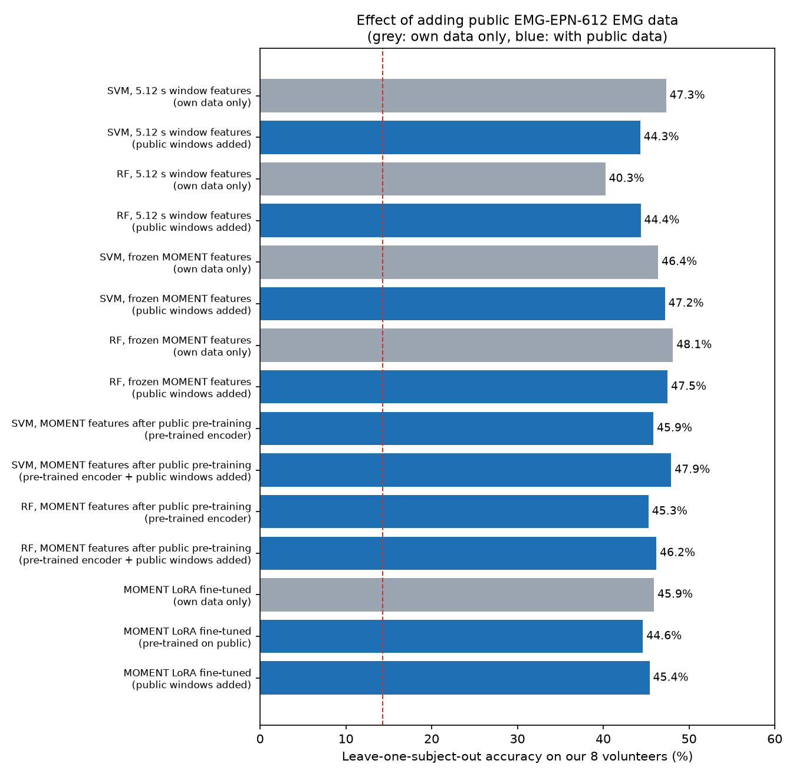

# Model comparison: classical models, MOMENT-1 before and after fine-tuning, and public data

On the same 8 volunteers and the same subject splits, the best EMG movement classifier is a **random forest on frozen (not fine-tuned) MOMENT-1 features: 48.1%** leave-one-subject-out accuracy over 7 movements (chance 14.3%). An SVM on hand-crafted features of the same 5.12 s windows is close behind (47.3%), and MOMENT-1 fine-tuned with LoRA reaches 45.9%. Adding public data (UCI, 36 people; EMG-EPN-612, 612 people) did not raise accuracy on our volunteers.

Results as of 2026-10-21, from `src/evaluation/compare_models.py` and `src/evaluation/public_data_gain.py`. Every fine-tuned model was reloaded from its saved files in `models/moment/` and reproduced its training score exactly.

> **Correction (2026-10-21).** Fine-tuning results published before this date were wrong. MOMENT enables gradient checkpointing by default; with its encoder frozen, this blocked every gradient to the LoRA adapters, so only the classification head ever trained (the "LoRA" and "linear probe" scores were therefore almost identical, and public-data pre-training had no effect). The fix (`enable_gradient_checkpointing: False` in `build_model`) is in place, the smoke test now fails if the adapters do not change, and every fine-tuning run was repeated. Classical and frozen-feature results were not affected.


## Setup

| Item | Value |
|---|---|
| Data | `Dataset/Healthy_person`, 8 volunteers (S02-S09; S01 excluded for 39% lost samples), 7 movements: Rest, Hand_Open, Hand_Close, Left, Right, Up, Down |
| Extra test | Stroke patient `SP01` (origin to be confirmed, see [datasets.md](datasets.md)); never trained on |
| Leave-one-subject-out (LOSO) | 8 folds; each tests one volunteer. Train on 6, the 7th is MOMENT's early-stopping subject (classical models skip it) |
| Holdout | Train S02-S05, validation S06 (MOMENT only), test S07+S08+S09 (903 windows, 129 per movement) |
| Splits | Read from the saved runs (`models/moment/*/folds/*/fold.json`), so every method sees exactly the same people |
| Metrics | Accuracy (classes are balanced) and macro F1; chance = 1/7 = 14.3% |

## Methods

| Group | Method | Input | What is trained |
|---|---|---|---|
| Classical, 200 ms | LDA, SVM (RBF, C=10), random forest (200 trees) | 8 features (RMS, MAV, VAR, STD, PEAK, WL, ZC, SSC) of 200 ms raw-envelope windows; 34,764 windows | Whole classifier |
| Classical, 5.12 s | Same three | Same 8 features of the 5.12 s preprocessed windows MOMENT sees (log1p, per-subject z-score); 2,494 windows | Whole classifier |
| MOMENT before fine-tuning | Untrained head | MOMENT-1-small as downloaded, random classification head | Nothing |
| MOMENT before fine-tuning | Frozen features + LDA / SVM / RF | 512-number MOMENT embedding of each 5.12 s window; no MOMENT weight changed. Two variants: our per-subject calibration, or MOMENT's own per-window normalisation (RevIN) | Only the classical classifier |
| MOMENT after fine-tuning | Linear probe (Phase A) | 5.12 s windows | MOMENT's classification head (3,591 parameters) |
| MOMENT after fine-tuning | LoRA (Phase B) | 5.12 s windows | LoRA adapters on attention q, v + head (118,279 parameters) |

## Results: leave-one-subject-out (8 volunteers)

| Group | Method | Accuracy | Macro F1 |
|---|---|---|---|
| Classical, 200 ms | LDA | 34.7% | 0.297 |
| Classical, 200 ms | SVM | 37.2% | 0.321 |
| Classical, 200 ms | Random forest | 34.0% | 0.307 |
| Classical, 5.12 s | LDA | 43.8% | 0.381 |
| Classical, 5.12 s | SVM | 47.3% | 0.425 |
| Classical, 5.12 s | Random forest | 40.2% | 0.367 |
| MOMENT before fine-tuning | Untrained head | 14.2% | 0.059 |
| MOMENT before fine-tuning | Frozen + LDA (calibrated) | 41.9% | 0.392 |
| MOMENT before fine-tuning | Frozen + SVM (calibrated) | 46.4% | 0.425 |
| MOMENT before fine-tuning | **Frozen + random forest (calibrated)** | **48.1%** | **0.443** |
| MOMENT before fine-tuning | Frozen + LDA (RevIN) | 31.4% | 0.288 |
| MOMENT before fine-tuning | Frozen + SVM (RevIN) | 35.0% | 0.313 |
| MOMENT before fine-tuning | Frozen + random forest (RevIN) | 35.3% | 0.304 |
| MOMENT after fine-tuning | Linear probe | 43.0% | 0.369 |
| MOMENT after fine-tuning | LoRA | 45.9% | 0.417 |

## Results: holdout (test S07, S08, S09)

| Group | Method | Accuracy | Macro F1 |
|---|---|---|---|
| Classical, 200 ms | LDA / SVM / random forest | 36.0% / 40.5% / 37.5% | 0.309 / 0.364 / 0.361 |
| Classical, 5.12 s | LDA / **SVM** / random forest | 40.3% / **50.2%** / 45.0% | 0.337 / **0.453** / 0.440 |
| MOMENT before fine-tuning | Untrained head | 17.4% | 0.082 |
| MOMENT before fine-tuning | Frozen + LDA / SVM / random forest (calibrated) | 45.2% / 48.3% / 49.3% | 0.436 / 0.469 / 0.463 |
| MOMENT before fine-tuning | Frozen + LDA / SVM / random forest (RevIN) | 27.4% / 31.8% / 29.2% | 0.252 / 0.293 / 0.262 |
| MOMENT after fine-tuning | Linear probe / LoRA | 45.5% / 48.7% | 0.401 / 0.453 |

The holdout has only three test volunteers, so LOSO (all 8) is the more reliable ranking.

## Results: stroke patient `SP01`

Trained on healthy volunteers only; LOSO values are the mean of the 8 fold models.

| Method | LOSO models | Holdout model |
|---|---|---|
| LDA / SVM / random forest, 200 ms | 15.6% / 14.8% / 17.6% | 14.3% / 14.1% / 15.2% |
| LDA / SVM / random forest, 5.12 s | 35.3% / 43.4% / 56.1% | 36.9% / 33.9% / 34.2% |
| Frozen MOMENT + LDA / SVM / random forest (calibrated) | 61.8% / 65.8% / **67.5%** | 37.2% / 39.2% / **42.9%** |
| Frozen MOMENT + LDA / SVM / random forest (RevIN) | 47.9% / 58.2% / 51.0% | 28.2% / 25.9% / 25.9% |
| MOMENT LoRA (fine-tuned) | 49.4% | 34.9% |

`SP01`'s signal is 5-8 times weaker than the healthy volunteers' and its origin is not documented, so these numbers show robustness to a very different signal, not clinical performance. The 200 ms models fail completely on it (chance level); per-subject calibration on 5.12 s windows is what makes transfer possible.

## Per movement (LOSO recall)

| Method | Rest | Hand_Open | Hand_Close | Left | Right | Up | Down |
|---|---|---|---|---|---|---|---|
| SVM, 200 ms | 81% | 46% | 66% | 23% | 9% | 19% | 11% |
| SVM, 5.12 s | 74% | 59% | **79%** | **47%** | **40%** | 23% | 5% |
| Frozen MOMENT + random forest | **78%** | 74% | 75% | 40% | 31% | 9% | **27%** |
| MOMENT LoRA | 65% | **82%** | 74% | 31% | 21% | 17% | 26% |

## Per volunteer (LOSO accuracy)

| Volunteer | SVM, 200 ms | SVM, 5.12 s | Frozen MOMENT + RF | MOMENT LoRA |
|---|---|---|---|---|
| S02 | 24.9% | 36.9% | 40.9% | 38.5% |
| S03 | 15.8% | 28.6% | 31.2% | 26.2% |
| S04 | 35.0% | 56.1% | 49.9% | 51.4% |
| S05 | 47.1% | 52.5% | 52.8% | 54.2% |
| S06 | 40.3% | 56.5% | 58.5% | 53.8% |
| S07 | 40.6% | 45.5% | 51.8% | 46.5% |
| S08 | 49.7% | 55.8% | 49.8% | 52.2% |
| S09 | 44.4% | 46.8% | 50.2% | 44.5% |

## Findings

1. **Window length matters most.** Moving the same SVM from 200 ms to 5.12 s windows raises LOSO accuracy from 37.2% to 47.3% (+10.1 points). Longer windows capture how activity changes during a movement.
2. **Pretrained MOMENT features help without any fine-tuning.** Frozen MOMENT embeddings with a random forest give the best LOSO result (48.1%) and the best patient result (67.5%).
3. **LoRA fine-tuning helps MOMENT but does not overtake frozen features.** Real LoRA training adds 2.9 points over the linear probe (45.9% vs 43.0% LOSO; 48.7% vs 45.5% holdout) and gives the best Hand_Open recall (82%), yet stays 2.2 points below frozen features + random forest. With about 1,900 training windows from 6 people, a non-linear classifier on fixed features generalises slightly better than adapting the encoder.
4. **Per-subject calibration is essential.** MOMENT's own per-window normalisation (RevIN) erases activity level and costs 11-13 points (35.3% vs 48.1% for the random forest).
5. **The untouched model is at chance** (14.2%): MOMENT must be adapted, at least with a trained classifier on its features.
6. **Hand gestures are learnable, directions are not.** Every method recognises Rest, Hand_Open and Hand_Close far better than Left, Right, Up and Down. One forearm channel carries little direction information, so the camera must keep deciding direction.
7. **Volunteers differ a lot.** S03 is hardest for every method (16-31%); S05 and S06 are easiest. With 8 people, differences of 1-2 points between the top methods are within this spread and should not be over-interpreted.

## Public data (UCI and EMG-EPN-612)

Two public datasets were converted to MD0437-like windows (see [datasets.md](datasets.md#public-data)) and used in three ways, always testing on our own volunteers with the same 8 LOSO folds:

- **Public windows added:** public windows whose labels match ours (Rest, Hand_Close, Hand_Open) join every training fold (UCI: all 2,120; EMG-EPN-612: a label-balanced sample of 3,000 of 68,850).
- **Pre-trained on public:** MOMENT's LoRA adapters first learn all public gestures (UCI: 6,288 windows, 7 gestures; EMG-EPN-612: a label-balanced 60,000 of 137,700 windows, 6 gestures), then are fine-tuned on our data with a new head.
- **Features after public pre-training:** the pre-trained encoder is frozen and an SVM or random forest is trained on its features.

Held-out accuracy of the pre-training itself (public people not trained on): UCI 36.2% over 7 gestures, EMG-EPN-612 53.7% over 6 gestures.

| Method | Own data only | + UCI | + EMG-EPN-612 |
|---|---|---|---|
| SVM, 5.12 s window features (public windows added) | **47.3%** | 43.2% | 44.3% |
| Random forest, 5.12 s window features (public windows added) | 40.3% | 43.4% | 44.4% |
| SVM, frozen MOMENT features (public windows added) | 46.4% | 47.2% | 47.2% |
| Random forest, frozen MOMENT features (public windows added) | **48.1%** | 47.8% | 47.5% |
| SVM, features of the public-pre-trained encoder | 46.4% | 44.1% | 45.9% |
| SVM, public-pre-trained encoder + public windows added | 46.4% | 45.2% | 47.9% |
| Random forest, features of the public-pre-trained encoder | 48.1% | 45.2% | 45.3% |
| Random forest, public-pre-trained encoder + public windows added | 48.1% | 45.7% | 46.2% |
| MOMENT LoRA, pre-trained on public | 45.9% | 45.0% | 44.6% |
| MOMENT LoRA, public windows added | 45.9% | not re-run | 45.4% |



Fine-tuned MOMENT per volunteer (LOSO accuracy):

| Volunteer | Own data only | Pre-trained on UCI | Pre-trained on EMG-EPN-612 | EMG-EPN-612 windows added |
|---|---|---|---|---|
| S02 | 38.5% | 30.9% | 36.2% | 36.9% |
| S03 | 26.2% | 24.6% | 26.9% | 23.6% |
| S04 | 51.4% | 46.0% | 43.4% | 56.6% |
| S05 | 54.2% | 53.2% | 49.5% | 56.8% |
| S06 | 53.8% | 53.2% | 52.5% | 50.5% |
| S07 | 46.5% | 50.5% | 49.2% | 44.2% |
| S08 | 52.2% | 53.8% | 48.2% | 49.5% |
| S09 | 44.5% | 48.2% | 51.2% | 45.2% |
| **Mean** | **45.9%** | 45.0% | 44.6% | 45.4% |
| Stroke patient `SP01` (mean of 8 models) | 49.4% | 53.9% | **55.4%** | 47.2% |

Why the public data did not help our volunteers:

1. **Different sensor.** Both datasets come from a raw 8-channel Myo armband; the conversion to an MD0437-like envelope is an approximation, and we do not know which armband channel matches our electrode site.
2. **Different recordings.** Public gestures are short (UCI about 1.8 s; EMG-EPN-612 about 1 s of gesture inside a 5 s recording), while our volunteers hold each movement for 60 s.
3. **Only 3 shared movements.** Directions (Left/Right/Up/Down) have no public equivalent, and adding Rest/Hand_Open/Hand_Close windows tilts training toward those classes.
4. **Pre-training learns the public data well but transfers poorly.** EMG-EPN-612 pre-training reached 53.7% on its own held-out people, yet the adapted encoder made our volunteers slightly worse (44.6% vs 45.9%). It did help the stroke patient (55.4% vs 49.4%), whose signal is also unlike our healthy volunteers'.

**Conclusion:** public armband data is not a substitute for recordings from our own sensor. The most reliable ways to raise accuracy are more volunteers recorded with the MD0437 setup, the missing S01 and S04 recordings, and, for direction movements, a second EMG channel.

## What this means for the application

- Keep the camera in charge of movement labels; EMG can help with hand open/close and activity feedback.
- For an EMG classifier, use 5.12 s windows with per-subject calibration, and frozen MOMENT features + random forest (or an SVM on window features, or LoRA-fine-tuned MOMENT for the best Hand_Open recall).
- Next improvements: more volunteers recorded with our own sensor, the missing S01 and S04 recordings, a second EMG channel for directions, and a short per-patient calibration recording.

## Reproduce

```bash
.venv/bin/python -m src.features.build_dataset --source public          # 200 ms features
.venv/bin/python -m src.data.prepare_finetune                            # 5.12 s windows
.venv-finetune/bin/python -m src.models.finetune_moment --split holdout
.venv-finetune/bin/python -m src.models.finetune_moment --split loso
.venv-finetune/bin/python -m src.evaluation.compare_models \
    --holdout-run models/moment/small_holdout_20261021-191854 \
    --loso-run models/moment/small_loso_20261021-192025                  # about 10 min

# Public data
.venv/bin/python -m src.data.download_public uci_gestures epn612         # 17 MB + 5.5 GB
.venv/bin/python -m src.data.public_emg uci_gestures
.venv/bin/python -m src.data.public_emg epn612                           # 137,700 windows, about 3 min
U=data/processed/public/uci_gestures_windows.npz; E=data/processed/public/epn612_windows.npz
.venv-finetune/bin/python -m src.models.finetune_moment --split loso --pretrain-data $U --tag uci_pretrain
.venv-finetune/bin/python -m src.models.finetune_moment --split loso --pretrain-data $E --max-pretrain 60000 --pretrain-epochs 5 --tag epn_pretrain
.venv-finetune/bin/python -m src.models.finetune_moment --split loso --extra-data $E --max-extra 3000 --tag epn_extra
.venv-finetune/bin/python -m src.evaluation.public_data_gain --name epn612 --loso-run models/moment/small_loso_20261021-192025 \
    --public $E --max-extra 3000 --encoder models/moment/small_loso_epn_pretrain_20261021-193241/pretrain \
    --finetuned models/moment/small_loso_20261021-192025 models/moment/small_loso_epn_pretrain_20261021-193241 models/moment/small_loso_epn_extra_20261021-210209
.venv-finetune/bin/python -m src.evaluation.public_data_gain --name public --loso-run models/moment/small_loso_20261021-192025 \
    --public $U --encoder models/moment/small_loso_uci_pretrain_20261021-201317/pretrain \
    --finetuned models/moment/small_loso_20261021-192025 models/moment/small_loso_uci_pretrain_20261021-201317
```

Outputs: `results/tables/model_comparison*.csv`, `public_data_gain*.csv` (UCI), `epn612_data_gain*.csv`, and `docs/figures/model_comparison.png`, `public_data_gain.png`, `epn612_data_gain.png`.
